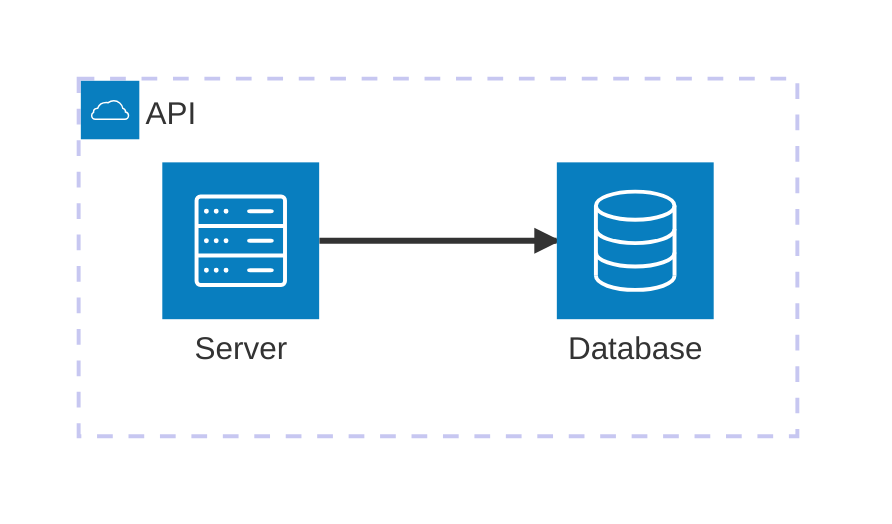

# Architecture diagram



## Syntax

```
group id(icon)[Label]
service id(icon)[Label] in group
junction id
a:R --> L:b      (sides: T, B, L, R)
a:B -- T:b       (no arrow)
```

Built-in icons: `cloud`, `database`, `disk`, `internet`, `server`.

Docs: <https://mermaid.js.org/syntax/architecture.html>
