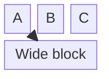

# Block diagram

`columns N` sets the grid width; `id:2` makes a block span 2 columns.
`space` leaves a gap. Nest with `block:group ... end`.
Shapes follow flowchart syntax, for example `db[("Database")]`.

Docs: <https://mermaid.js.org/syntax/block.html>
