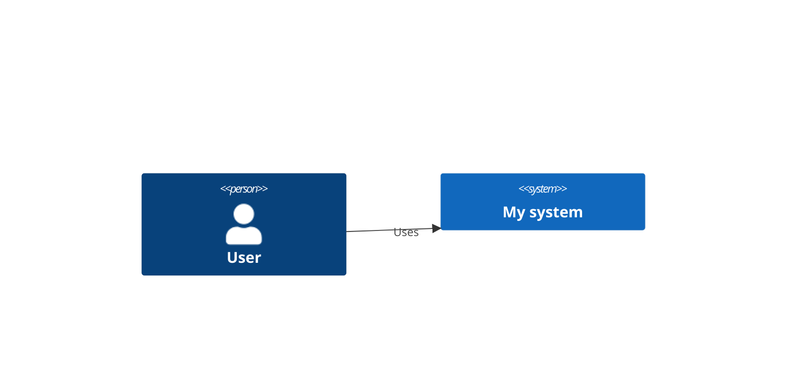

# C4 diagram



Diagram kinds: `C4Context`, `C4Container`, `C4Component`, `C4Dynamic`, `C4Deployment`.

## Elements

```
Person(alias, "Label", "Description")
Person_Ext(...)
System(...) / System_Ext(...) / SystemDb(...)
Container(alias, "Label", "Technology", "Description")
ContainerDb(...) / Component(...)
Enterprise_Boundary(b1, "Name") { ... }
System_Boundary(b2, "Name") { ... }
```

## Relationships

```
Rel(from, to, "Label", "Technology")
BiRel(a, b, "Label")
Rel_U / Rel_D / Rel_L / Rel_R  (direction hints)
UpdateRelStyle(from, to, $textColor="red", $offsetY="-10")
```

Docs: <https://mermaid.js.org/syntax/c4.html>
