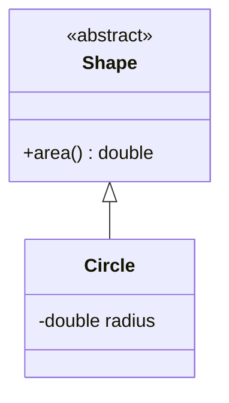

# Class diagram



## Members

`+` public, `-` private, `#` protected, `~` package. Methods end in `()`.
Add `$` for static and `*` for abstract: `+count()$`.

## Relationships

| Code | Meaning |
| --- | --- |
| `A <|-- B` | inheritance |
| `A *-- B` | composition |
| `A o-- B` | aggregation |
| `A --> B` | association |
| `A ..> B` | dependency |
| `A ..|> B` | realisation |
| `A "1" --> "*" B : label` | cardinality and label |

## Other

```
class Duck~T~
<<interface>> Flyer
namespace Animals {
    class Dog
}
note for Dog "Good boy"
direction LR
```

Docs: <https://mermaid.js.org/syntax/classDiagram.html>
