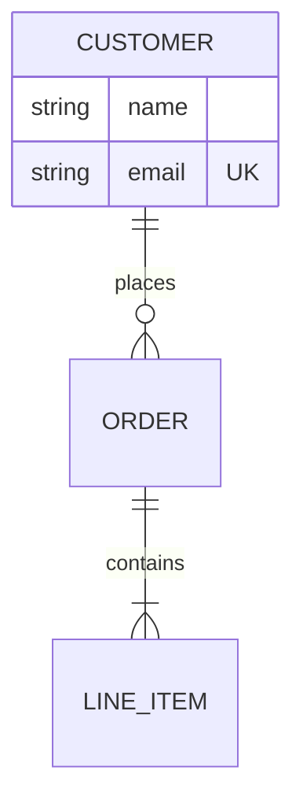

# Entity relationship



## Cardinality (left side / right side)

| Code | Meaning |
| --- | --- |
| `|o` / `o|` | zero or one |
| `||` | exactly one |
| `}o` / `o{` | zero or more |
| `}|` / `|{` | one or more |

Use `--` for identifying (solid) and `..` for non-identifying (dashed) relationships.

## Attributes

```
ENTITY {
    int id PK
    int other_id FK
    string code UK "comment"
}
```

Docs: <https://mermaid.js.org/syntax/entityRelationshipDiagram.html>
