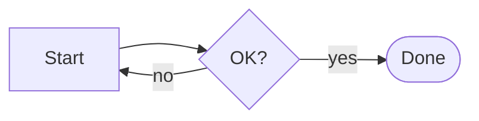

# Flowchart

Start with `flowchart` and a direction: `TD` (top-down), `LR`, `BT` or `RL`.



## Node shapes

| Code | Shape |
| --- | --- |
| `A[Text]` | rectangle |
| `A(Text)` | rounded |
| `A([Text])` | stadium |
| `A[[Text]]` | subroutine |
| `A[(Text)]` | database |
| `A((Text))` | circle |
| `A{Text}` | diamond |
| `A{{Text}}` | hexagon |
| `A>Text]` | flag |
| `A[/Text/]` | parallelogram |

## Links

| Code | Meaning |
| --- | --- |
| `A --> B` | arrow |
| `A --- B` | open line |
| `A -.-> B` | dotted |
| `A ==> B` | thick |
| `A -->|label| B` | labelled |
| `A --o B` / `A --x B` | circle / cross end |
| `A <--> B` | both ways |

## Subgraphs and styling

```
subgraph one [Group title]
    direction LR
    a1 --> a2
end
classDef hot fill:#f96,stroke:#333
class a1 hot
style a2 fill:#bbf
```

Docs: <https://mermaid.js.org/syntax/flowchart.html>
