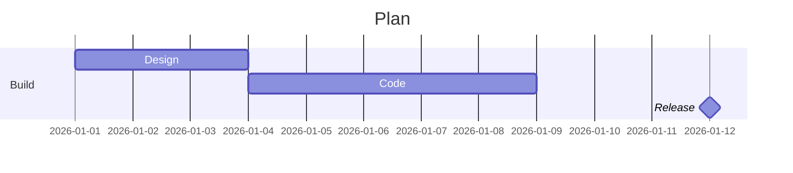

# Gantt chart



## Task syntax

`Name :[tags,] [id,] start, end-or-duration`

| Part | Examples |
| --- | --- |
| tags | `done`, `active`, `crit`, `milestone` |
| start | `2026-01-01`, `after a1` |
| duration | `3d`, `12h`, `1w` |

## Settings

```
dateFormat YYYY-MM-DD
axisFormat %d %b
excludes weekends
todayMarker off
tickInterval 1week
```

Docs: <https://mermaid.js.org/syntax/gantt.html>
