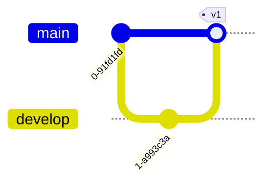

# Git graph

## Commands

| Code | Meaning |
| --- | --- |
| `commit id: "msg" tag: "v1" type: HIGHLIGHT` | commit (`NORMAL`, `REVERSE`, `HIGHLIGHT`) |
| `branch name order: 2` | create and switch to a branch |
| `checkout name` | switch branch |
| `merge name` | merge into current branch |
| `cherry-pick id: "abc"` | cherry-pick a commit |

Docs: <https://mermaid.js.org/syntax/gitgraph.html>
