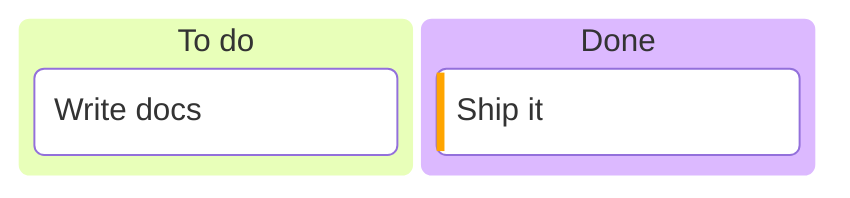

# Kanban board

Columns are top-level items; tasks are indented below them.
Add metadata with `@{ assigned: 'kev', ticket: 42, priority: 'High' }`.

Docs: <https://mermaid.js.org/syntax/kanban.html>
