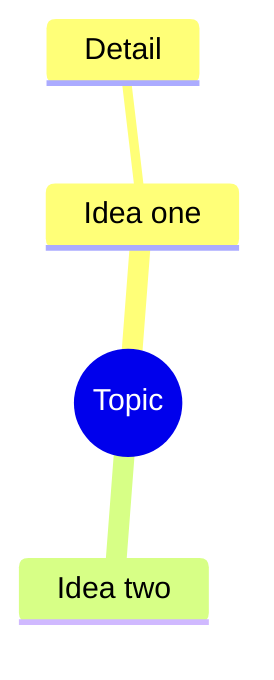

# Mindmap

Indentation sets the hierarchy. Node shapes work like flowcharts:
`[square]`, `(rounded)`, `((circle))`, `))bang((`, `)cloud(`, `{{hexagon}}`.

Add an icon with `::icon(fa fa-book)` and a class with `:::urgent`.

Docs: <https://mermaid.js.org/syntax/mindmap.html>
