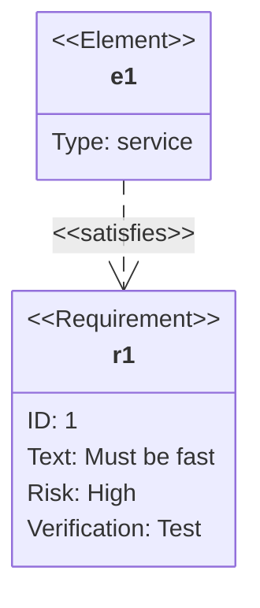

# Requirement diagram

Requirement types: `requirement`, `functionalRequirement`, `interfaceRequirement`,
`performanceRequirement`, `physicalRequirement`, `designConstraint`.

Risk: `low`, `medium`, `high`. Verify method: `analysis`, `inspection`, `test`, `demonstration`.

Relationships: `contains`, `copies`, `derives`, `satisfies`, `verifies`, `refines`, `traces`.

Docs: <https://mermaid.js.org/syntax/requirementDiagram.html>
