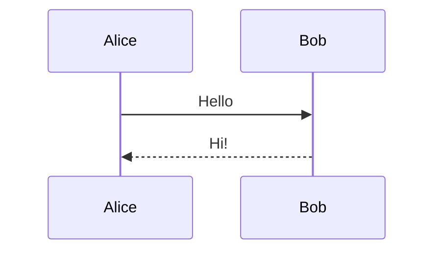

# Sequence diagram



## Participants

```
participant A as Alice
actor U as User
create participant C
destroy C
box Aqua Backend
    participant S
end
```

## Messages

| Code | Arrow |
| --- | --- |
| `->` | solid line, no arrow |
| `-->` | dotted line, no arrow |
| `->>` | solid with arrowhead |
| `-->>` | dotted with arrowhead |
| `-x` | solid with cross |
| `-)` | async (open arrow) |
| `->>+` / `-->>-` | activate / deactivate |

## Blocks

```
loop Every minute
    A->>B: ping
end
alt success
    B->>A: ok
else failure
    B->>A: error
end
opt Optional
    A->>B: extra
end
par In parallel
    A->>B: one
and
    A->>C: two
end
Note right of A: A note
Note over A,B: Spans both
autonumber
```

Docs: <https://mermaid.js.org/syntax/sequenceDiagram.html>
