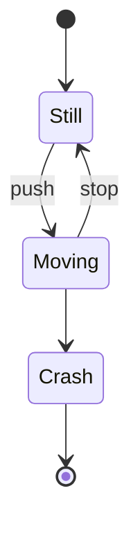

# State diagram



## Syntax

| Code | Meaning |
| --- | --- |
| `[*]` | start / end |
| `A --> B : label` | transition |
| `state "Long name" as A` | description |
| `state fork <<fork>>` | fork / `<<join>>` / `<<choice>>` |
| `note right of A : text` | note |

## Composite states and concurrency

```
state Active {
    [*] --> Running
    Running --> Paused
    --
    [*] --> Logging
}
```

Docs: <https://mermaid.js.org/syntax/stateDiagram.html>
